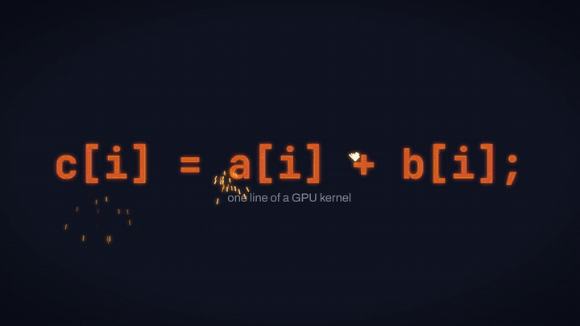

# WarpForge

An optimizing compiler, written in C++20, from a small C-like GPU kernel language to NVIDIA PTX. Its output is
verified bit-for-bit on real hardware.

[](https://github.com/JothishKamal/warp-forge/actions/workflows/ci.yml)


[](docs/media/warpforge-demo.mp4)

<sub>**[▶ Watch the full 44-second film with sound](docs/media/warpforge-demo.mp4)** (1080p, 60 fps). The GIF above
is a silent highlight reel. Every line of code on screen is real compiler output: the forge sequence replays
the IR after each pass of an actual `--print-after-all` run.</sub>

---

WarpForge takes a kernel like this:

```c
kernel vector_add(float* a, float* b, float* c, int n) {
    int i = global_id();
    if (i < n) {
        c[i] = a[i] + b[i];
    }
}
```

It then lexes, parses and type-checks the kernel, lowers it to SSA, optimizes it with classic dataflow passes,
translates it out of SSA, and emits PTX that `ptxas` assembles and an RTX 3060 runs. The result is
bit-identical to a CPU reference.

The language is deliberately narrow: no loops, no calls, three types. That leaves room to get the compiler
itself right, with a verifier between every stage, semantics pinned down to the bit, and tests at every level
up to the GPU.

## Highlights

- **Real SSA.** Constructed directly with Braun et al.'s algorithm: phis are placed on demand and trivial
  phis removed. A verifier checks types, the CFG, phis and def-dominates-use (Cooper–Harvey–Kennedy
  dominators) after every pass.
- **Textbook optimizations.** Constant folding, sparse conditional constant propagation (Wegman–Zadeck),
  mark-sweep DCE and CFG simplification, run to a fixpoint. `--print-after-all` shows each step.
- **Correct out-of-SSA.** Critical-edge splitting and parallel-copy sequentialization handle both the
  lost-copy and the swap problem.
- **GPU-exact semantics.** `.rn` float ops stop `ptxas` contracting to FMA. NaNs are canonicalized as PTX
  does. Float negation is an exact sign-bit `xor`, because PTX leaves `neg.f32` of a NaN unspecified. Folding
  at -O1 and computing on the GPU at -O0 give the same bits.
- **Validated against NVIDIA's tools.** `ptxas` assembles every output, the CUDA driver's JIT loads it, and
  the GPU's results match the reference interpreter bit-for-bit, including a 300-run random-program fuzz.
- **Helpful diagnostics.** GCC-style `file:line:col` errors with carets, several per run, and specific
  messages for unsupported C (`'while' is not supported in WarpForge`).

## Quick start

You need CMake ≥ 3.20, Python 3 and a C++20 compiler. GCC 13, Clang 17 and MSVC 2022 are all tested with
warnings as errors. A GPU is optional.

```sh
git clone https://github.com/JothishKamal/warp-forge.git && cd warp-forge
cmake --preset mingw-gcc                 # or: msvc, mingw-clang, ci (Linux)
cmake --build build/mingw-gcc
ctest --test-dir build/mingw-gcc         # GPU and ptxas tests skip without NVIDIA hardware
```

Compile a kernel, and look inside:

```sh
warpforge examples/vector_add.wf -o vector_add.ptx           # PTX for sm_86
warpforge examples/saxpy_const.wf --dump-ir --no-opt         # SSA straight from the front end
warpforge examples/saxpy_const.wf --print-after-all --dump-ir   # watch each pass (log on stderr)
```

Run it on an NVIDIA GPU. Only the display driver is needed, not the CUDA Toolkit:

```sh
wf-run --source examples/vector_add.wf --ptx vector_add.ptx --kernel vector_add --check
# device: NVIDIA GeForce RTX 3060 Laptop GPU (sm_86), CUDA driver API 13.3
# PASS vector_add n=1048576 threads=1048576 (bit-exact vs IR interpreter and C++ loop)
```

## What the optimizer does

[`examples/saxpy_const.wf`](examples/saxpy_const.wf) hides a simple `y = 3x + y` behind constant arithmetic
and dead code:

```c
float scale = 2.0 * 1.5;   // const-fold: 3.0
int unused = i * 4 + 7;    // dce: deleted
int lanes = 32 * 8;        // const-fold: 256
if (lanes < 0) { ... }     // sccp: never taken, so the block is deleted
```

<table><tr><th><code>--dump-ir -O0</code> (29 lines)</th><th><code>--dump-ir -O1</code> (18 lines)</th></tr><tr><td>

```llvm
entry:
  %i = global_id
  %scale = mul.f32 0x40000000, 0x3FC00000
  %0 = mul.i32 %i, 4
  %unused = add.i32 %0, 7
  %lanes = mul.i32 32, 8
  %1 = lt.i32 %lanes, 0
  condbr %1, if.then, if.end
if.then:
  %2 = addr %y, %i
  store.f32 0x00000000, %2
  br if.end
if.end:
  %3 = lt.i32 %i, %n
  condbr %3, if.then.1, if.end.1
  ...
```

</td><td>

```llvm
entry:
  %i = global_id
  %0 = lt.i32 %i, %n
  condbr %0, if.then.1, if.end.1

if.then.1:
  %1 = addr %x, %i
  %2 = load.f32 %1
  %3 = mul.f32 0x40400000, %2
  %4 = addr %y, %i
  %5 = load.f32 %4
  %6 = add.f32 %3, %5
  %7 = addr %y, %i
  store.f32 %6, %7
  br if.end.1
  ...
```

</td></tr></table>

The PTX it emits for `vector_add` (abridged; full output in [`tests/golden/`](tests/golden)):

```ptx
	mad.lo.s32 	%r5, %r2, %r3, %r4;      // global_id(): ctaid.x * ntid.x + tid.x
	setp.lt.s32 	%p1, %r5, %r1;           // i < n
	@!%p1 bra 	$L__BB0_2;
	mul.wide.s32 	%rd7, %r5, 4;
	add.s64 	%rd8, %rd2, %rd7;
	ld.global.f32 	%f1, [%rd8];
	...
	add.rn.f32 	%f3, %f1, %f2;           // explicit .rn: no FMA contraction
	st.global.f32 	[%rd12], %f3;
$L__BB0_2:
	ret;
```

## How it works

```
 .wf ─► lexer ─► parser ─► sema ─► IRGen (SSA) ─► verifier ⇄ passes ─► out of SSA ─► PTX
                                                   const-fold, sccp, dce, simplify-cfg
```

| Stage | What it does | Read more |
|---|---|---|
| Front end | Hand-written lexer and recursive-descent parser with error recovery; type checker | [language.md](docs/language.md) |
| IR | SSA with basic blocks, use lists and typed values; stable text form that also parses back (`.wfir`) | [ir.md](docs/ir.md) |
| Passes | Four passes and a pass manager that verifies after each one | [passes.md](docs/passes.md) |
| Backend | Out-of-SSA, typed virtual registers (no register allocation: `ptxas` owns that), then-first block layout | [codegen.md](docs/codegen.md) |
| `wf-run` | Loads `nvcuda.dll` / `libcuda.so` at run time, JIT-compiles PTX through `cuModuleLoadDataEx`, and compares GPU output with the interpreter | [validation.md](docs/validation.md) |

## Correctness

| Check | What it proves |
|---|---|
| Unit tests (GoogleTest) | Every component in isolation: lexer, parser, sema, IR, verifier, each pass, out-of-SSA, emitter |
| Golden files | Tokens, AST, IR and PTX for every example are byte-identical on GCC, Clang and MSVC, and on Windows and Linux |
| Diagnostics | 28 invalid programs, each with the exact `line:col` and message expected |
| Single-pass IR tests | Hand-written `.wfir` in, expected IR out, like LLVM's `opt` tests |
| Differential | -O0 and -O1 write bit-identical memory on the interpreter: every example plus 500 random programs |
| `ptxas` | Every golden PTX file assembles with `ptxas -arch=sm_86` (CUDA 13.3) |
| GPU | Every example at -O0 and -O1, plus 150 random programs at both levels, matches the interpreter bit-for-bit on an RTX 3060 |

CI runs the CPU suite on Linux (GCC) and Windows (MSVC). The GPU and `ptxas` checks skip cleanly without
NVIDIA hardware.

## Performance

RTX 3060 Laptop GPU, n = 2²⁴, 200 warmup and 200 timed launches. Every variant passed the bit-exact check
first:

| Kernel | WarpForge -O0 | WarpForge -O1 | nvcc `-O3 -fmad=false` | PTX instructions (O0 / O1 / nvcc) | SASS |
|---|---|---|---|---|---|
| `vector_add` | 0.665 ms | 0.665 ms | 0.665 ms | 24 / 24 / 22 | 16 each |
| `saxpy_const` | 0.670 ms | 0.676 ms | 0.670 ms | 35 / 23 / 20 | 16 each, identical |

WarpForge's PTX runs at nvcc's speed, about 303 GB/s, close to the card's memory bandwidth. Because `ptxas`
re-optimizes its input, -O1 shrinks the PTX rather than the kernel time: for `saxpy_const`, all three variants
compile to the same machine code. Method and caveats: [benchmarks.md](docs/benchmarks.md).

## The language

`int` (32-bit, wrapping), `float` (IEEE binary32) and `float*` (global memory, kernel parameters only).
Declarations with initializers, assignments, indexed loads and stores, `if` / `else if` / `else`, and
`return;`. Expressions use `+ - *`, unary `-`, `<` (in conditions), parentheses and `global_id()`. There are
no loops, calls or implicit conversions. The grammar and every diagnostic are in
[language.md](docs/language.md).

```
examples/bad.wf:2:20: error: invalid operands to '+': float and int
    float x = o[0] + n;
                   ^
```

## Command line

| Option | |
|---|---|
| `-o`, `--emit-ptx <file>` | Write PTX (`-` for stdout) |
| `--dump-tokens`, `--dump-ast`, `--dump-ir` | Print a stage's output |
| `-O0`, `-O1` (`--no-opt`, `--opt`) | Optimization level (default `-O1`) |
| `--passes=a,b,...` | Run exactly these passes |
| `--print-before-all`, `--print-after-all` | Trace the pipeline on stderr |
| `--input-ir` | Read textual IR (implied by `.wfir`) |
| `--sm=<arch>`, `--ptx-version=<x.y>` | Target `sm_75`–`sm_90` (default `sm_86`) |
| `--check` | Stop after type checking |

## Limitations

These are deliberate choices, made so the compiler stays narrow and correct:

- No loops, function calls, division, `>`/`==`, casts or pointer arithmetic; 1-D `global_id()` only.
- No register allocation, scheduling or CSE. Those belong to `ptxas`, which already does them.
- No shared memory, barriers or atomics, so kernels must be race-free. The interpreter detects races and
  out-of-bounds accesses.

## Repository layout

```
src/frontend   lexer, parser, AST, sema, diagnostics
src/ir         IR, printer and parser, verifier, dominators, IRGen, evaluator, interpreter
src/passes     pass manager and the four passes
src/codegen    out-of-SSA and the PTX emitter
src/driver     command-line driver
tools/         warpforge (CLI) and wf-run (GPU harness)
tests/         unit, golden, diagnostic, IR and GPU-fuzz suites
examples/      sample kernels
bench/         benchmark harness and nvcc baselines
demo/          the Remotion source for the video above
docs/          design notes and references
```

## Documentation

- [Language](docs/language.md): grammar, semantics and diagnostics
- [IR](docs/ir.md): structure, text format and verifier
- [Passes](docs/passes.md), with a page each for [const-fold](docs/passes/const-fold.md),
  [sccp](docs/passes/sccp.md), [dce](docs/passes/dce.md) and [simplify-cfg](docs/passes/simplify-cfg.md)
- [Code generation](docs/codegen.md): IR→PTX mapping, out-of-SSA, NaN and negation semantics
- [Validation](docs/validation.md) and [benchmarks](docs/benchmarks.md)
- [Design Q&A](docs/interview-guide.md): why each decision was made
- [Design document](docs/superpowers/specs/2026-10-20-warpforge-design.md)

## The demo video

The film is a [Remotion](https://www.remotion.dev) project in [`demo/`](demo), built so it can't drift from the
compiler or from its own soundtrack:

- **Real content.** `scripts/sync-content.mjs` pulls the source, tokens, CFG, PTX and the IR after each pass
  from this repository's examples and golden outputs. When a build exists, it runs `warpforge
  --print-after-all` for the pass snapshots.
- **Synthesized sound.** `scripts/make-audio.py` (numpy and scipy) generates every sound from scratch, so
  nothing needs licensing: kick, sub bass, pad, risers, anvil clangs, glitches, key clicks.
- **One timeline.** [`demo/timeline.json`](demo/timeline.json) holds every cut, hit and cue. The video and the
  synthesizer both read it, so picture and sound land on the same frame.

```sh
cd demo && npm ci
npm run studio        # live preview, with sound
npm run render        # demo/out/warpforge-demo.mp4 (1080p, 60 fps, AAC audio)
npm run render:gif    # demo/out/warpforge-teaser.gif (the preview above)
```

`docs/media/warpforge-demo.mp4` is the render re-encoded for the web (`-crf 21 -movflags +faststart`), and
`docs/media/warpforge-teaser.gif` is a copy of the teaser.
